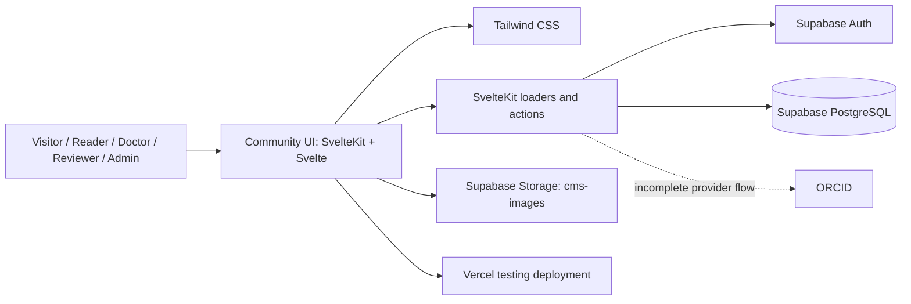
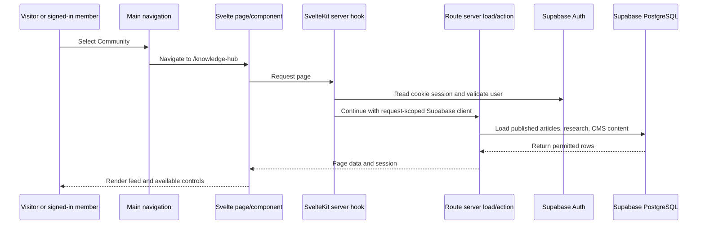
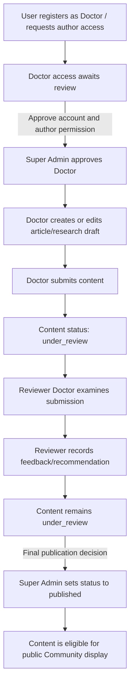

# Jarurat Care Community — Handover & Documentation

**Last Verified:** [PLACEHOLDER: YYYY-MM-DD — update after the next project/deployment verification]

### Table of Contents

- [1. Quick Summary](#1-quick-summary)
- [2. Local Setup Guide](#2-local-setup-guide)
- [3. Tech Stack & External Services](#3-tech-stack--external-services)
- [4. Project Features & User Journeys](#4-project-features--user-journeys)
- [5. Repository & Architecture Map](#5-repository--architecture-map)
- [6. Environment Variables](#6-environment-variables)
- [7. Database & Storage](#7-database--storage)
- [8. Roles & Permissions](#8-roles--permissions)
- [9. Features & Current Status](#9-features--current-status)
- [10. Authentication](#10-authentication)
- [11. Deployment & Release Process](#11-deployment--release-process)
- [12. Known Issues & Pending Work](#12-known-issues--pending-work)
- [13. Troubleshooting](#13-troubleshooting)
- [14. Third-Party Services & Access Transfer](#14-third-party-services--access-transfer)

# 1. Quick Summary

## Project Objective

- Provide patients, caregivers, healthcare professionals, and the wider public with a single place to discover published Community knowledge.
- Support multiple content formats: articles, research papers, blogs, news, events, FAQs, testimonials, and campaigns.
- Provide member accounts and role-based dashboards, an editorial CMS, and a Doctor-content review and publishing workflow.

## Target Department

- **Tech**

## Live Status

- **In Testing / Not in Production:** The Community section is not currently available on the `jarurat.care` production site. It is deployed at the testing URL below.
- The main foundation website is live separately; do not treat that as evidence that the Community module has been released to production.
- Individual features have different levels of completeness; refer to the feature/status section and Known Issues section as they are added.

## Live URL / Staging Link

- **Community testing site:** [https://jarurat-care-website-red.vercel.app/](https://jarurat-care-website-red.vercel.app/)
- **Main production website (Community is not released here):** [https://www.jarurat.care](https://www.jarurat.care)
- **Repository:** [https://github.com/jaruratcare/jarurat-care-website](https://github.com/jaruratcare/jarurat-care-website)
- **Documented default branch:** `deploy`
- **Branch used for Community/CMS documentation work:** `cms-test`
- **Testing Vercel project/branch:** [VERIFY: confirm which branch deploys to the testing URL before publishing changes.]

## Intended Users

| User | How they relate to Community |
|---|---|
| Visitor | Browses published Knowledge Hub content and public Doctor profiles without signing in. |
| New account holder | Starts with the initial `user` role and completes a profile before using the relevant member experience. |
| Reader | Uses the Reader dashboard to find saved content, followed Doctors, recommendations, and profile interests; signed-in member interactions include saving, liking, and commenting on content and following Doctors. |
| Doctor | After the Super Admin approves the account, creates and manages article and research submissions. |
| Reviewer | A Doctor with the `is_reviewer` permission flag who reviews another Doctor's submissions. Reviewer is not a separate account role; the Doctor can also author if `is_author` is enabled. |
| Admin | Creates, edits, publishes, and manages CMS editorial content such as blogs, news, events, FAQs, and campaigns. |
| Super Admin | Approves Doctors, manages roles and author permissions, and performs final publication of Doctor-authored submissions. |

## Main Community Areas

- **Knowledge Hub:** Community entry in the website navigation; route `/knowledge-hub`. Combines published Doctor articles, research papers, and CMS content.
- **Discovery tools:** Search by keyword, filter by content type, sort by date/title, switch grid/list display, and paginate through results (documented page size: up to nine items).
- **Content details:** Route `/content/{type}/{slug}` opens an individual published item.
- **Doctor profiles:** Public profile route `/doctors/{id}`.
- **Reader experience:** Member dashboard for saved content, followed Doctors, recommendations, interests, and community interactions.
- **Doctor and Reviewer workflow:** Doctors submit articles/research; Reviewers record feedback; Super Admins perform final publication.
- **Editorial CMS:** Admins and Super Admins manage blogs, news, events, FAQs, and campaigns without the Doctor-review workflow.

## Current Documented Status

The following is a summary of project documentation, **not a fresh production test**.

| Area | Status for handover purposes |
|---|---|
| Knowledge Hub and content discovery | Documented as live/implemented; production content and image links need checking. |
| Search, filters, sorting, grid/list display, and pagination | Documented as implemented; not independently tested for this handover. |
| Email/password and Google sign-in | Implemented; redirects and provider configuration need follow-up. |
| ORCID sign-in | Code is present, but the flow is currently not working; fixes and end-to-end testing are pending. Not production-ready. |
| Reader, Doctor, Reviewer, Admin, and Super Admin areas | Routes and dashboards exist; known workflow and permission mismatches need follow-up. |
| CMS for blogs, news, events, FAQs, and campaigns | Documented as implemented; creating testimonials through CMS is a known gap. |
| Doctor article/research review and publication | Workflow exists; Reviewer feedback and final Super Admin publication are separate steps. |
| Supabase schema and RLS setup | Table definitions are available in a standalone setup script; deployed schema and access policies must be confirmed before relying on them. |

# 2. Local Setup Guide

## Prerequisites

- Node.js 24.x
- npm
- Git
- Supabase project for Community database and authentication
- ORCID credentials only if configuring or testing the implemented but currently non-working ORCID flow

## Clone and install

In PowerShell, clone the repository and install its dependencies:

```powershell
git clone https://github.com/jaruratcare/jarurat-care-website.git
Set-Location jarurat-care-website
npm ci
```

When installation completes, the project dependencies are available locally. The repository's documented default branch is `deploy`; confirm with the maintainer if Community development should use a different branch.

## Environment setup

Create a `.env` file in the repository root and add the variables below, using values from an authorized development Supabase project:

```text
PUBLIC_CMS_SUPABASE_URL=
PUBLIC_CMS_SUPABASE_ANON_KEY=
SUPABASE_SERVICE_ROLE_KEY=
ORCID_CLIENT_ID=
ORCID_CLIENT_SECRET=
ORCID_REDIRECT_URI=http://localhost:5173/cms/auth-callback
```

Keep `.env` private and never commit credentials. `SUPABASE_SERVICE_ROLE_KEY` is privileged and must remain server-side. ORCID configuration is only needed when investigating or testing its implemented but currently non-working flow.

## Supabase database setup

The application requires the Community tables and appropriate access policies. For a **new, empty Supabase project**, use [`scripts/supabase-setup.sql`](./scripts/supabase-setup.sql) in the Supabase Dashboard's SQL Editor. Run it once only. It creates tables and enables RLS, but does not add access policies. Do not run it against an existing or production database. See [`read.md`](./read.md#-supabase-database-setup) for the SQL Editor steps and policy warning.

## Run and check

Start the development server:

```powershell
npm run dev
```

Open the local URL printed by Vite, normally [http://localhost:5173](http://localhost:5173). To run the project checks or create a production build:

```powershell
npm run check
npm run build
```

# 3. Tech Stack & External Services

The Community is implemented as part of the existing Jarurat Care SvelteKit application. Its pages and dashboards run in the browser, while SvelteKit server loaders/actions connect those pages to Supabase and handle operations that need a server-side session or privileged access.

## Application framework and language

| Technology | What it is | How it is used in Community |
|---|---|---|
| **SvelteKit 2** | Full-stack framework built around Svelte and file-based routing. It supports browser-rendered pages as well as server-side page loading and actions. | Powers `/knowledge-hub`, public content details, authentication routes, dashboards, CMS routes, and the server code paired with those pages. A route folder maps to a URL; `+page.svelte` renders UI and `+page.server.ts` can load data or process form actions. |
| **Svelte 4** | Component framework for building reactive user interfaces. | Renders content cards, filters, forms, editor screens, role dashboards, navigation, and reusable components. |
| **TypeScript and JavaScript** | Languages used for application code. TypeScript adds static type checking; JavaScript is also used in existing modules. | Route loaders/actions and shared utilities are written in both `.ts` and `.js` files. Follow the language and conventions of the file being changed. |
| **Node.js 24 or newer** | JavaScript runtime used by the local toolchain and build. | `package.json` declares the project engine requirement as `>=24.0.0`. |

## Styling and authoring interface

| Technology | What it is | How it is used in Community |
|---|---|---|
| **Tailwind CSS 3** | Utility-first CSS framework. | Provides styling classes for Knowledge Hub cards, content layouts, login/forms, and dashboards; project configuration is in `tailwind.config.js` and global CSS. |
| **TipTap** | Rich-text editor framework. | Used in content-authoring experiences so CMS/Doctor content can be composed with formatting rather than plain text alone. |
| **Lucide Svelte and Iconify** | Svelte-compatible icon libraries. | Supply icons used across Community navigation, content controls, and dashboard UI. |
| **Marked** | Markdown parser. | Available for Markdown rendering where Community content uses Markdown; check the particular route/component before assuming all rich text passes through Marked. |
| **Svelte French Toast** | Toast/notification UI library. | Displays short in-app feedback messages for actions such as form submissions or status changes where used. |

## Build, package, and code-quality tools

| Tool | Role in the project |
|---|---|
| **Vite** | Runs the local development server and provides the build pipeline used by SvelteKit. `npm run dev` starts the development server. |
| **npm** | Installs packages using the repository's `package-lock.json`. The setup documentation uses `npm ci` to install the locked dependency set. |
| **TypeScript / `svelte-check`** | Checks TypeScript and Svelte component diagnostics; run with `npm run check`. |
| **ESLint** | Lints code; included in the `npm run lint` script. |
| **Prettier** | Checks formatting as part of `npm run lint`; `npm run format` applies formatting. |
| **Vercel adapter for SvelteKit** | Adapter package used to prepare the SvelteKit application for Vercel hosting. |

`package.json` declares these ranges: SvelteKit `^2.70.1`, Svelte `^4.2.7`, TypeScript `^5.6.2`, Tailwind CSS `^3.4.4`, and Vite `^5.4.21`. These are manifest ranges, not verified versions running on the current deployment. The project manifest also records a pnpm package-manager field while the repo has an npm lockfile and setup instructions; use the documented npm workflow unless the maintainer confirms a package-manager change.

## Data and identity services

| Service | What it provides | Community use and handover notes |
|---|---|---|
| **Supabase PostgreSQL** | Managed relational database. | Stores member profiles and role flags, articles, research, editorial CMS records, comments, likes, saved items, follows, review feedback, notifications, and analytics. The standalone SQL file contains supplied table definitions for a new empty project, but does not define application RLS policies. |
| **Supabase Auth** | User identity, sign-in, session, and email authentication services. | Community email/password and Google sign-in use Supabase Auth. Email confirmation, provider setup, and redirect allowlists are configured in the Supabase project and must match the target environment. |
| **Supabase Storage** | Object storage for files/images associated with a Supabase project. | The documented Community bucket is `cms-images`. Verify the bucket exists and check its upload/read policies and image URLs; broken Community image links have been reported. |
| **Google OAuth** | Third-party identity provider connected through Supabase Auth. | Allows Google sign-in when enabled and configured. The provider's client configuration and callback URLs must be maintained by an authorized owner; live production settings are not confirmed here. |
| **ORCID** | Researcher identity provider. | ORCID login code exists, but the flow is currently not working; fixes and end-to-end testing are pending. Do not describe it as an available production sign-in method until verified. |

## Hosting service

| Service | Community use | Current information |
|---|---|---|
| **Vercel** | Hosts the SvelteKit build and provides the Community testing deployment. | The supplied Community testing URL is [https://jarurat-care-website-red.vercel.app/](https://jarurat-care-website-red.vercel.app/). Confirm the linked Vercel project, deployment branch, environment variables, and preview/production designation with the project owner. |

## How the pieces work together

1. A visitor or member opens a Community route served by the SvelteKit application.
2. Svelte renders the page and reusable components; Tailwind supplies the styling.
3. A route's server loader or action obtains the required page data or processes a user action.
4. Supabase Auth identifies the current member/session. The route uses Supabase PostgreSQL for Community content and profile data and may use Supabase Storage URLs for images.
5. The application returns the page data or action result to the browser. Vercel hosts the deployed application; it is not the database or identity provider.



**Security boundary:** The public/anon Supabase key is used by browser and user-scoped clients. A service-role key bypasses RLS and must only be used in server-only code. Never expose it to Svelte components, browser bundles, or a public environment variable. See the Supabase client notes in [Repository & Architecture Map](#5-repository--architecture-map).

# 4. Project Features & User Journeys

The Community has two distinct content-publishing paths:

1. **Editorial CMS content** is created and published by an Admin or Super Admin without Doctor review.
2. **Doctor-authored articles and research** go through Doctor approval, Reviewer feedback, and a final publication action by a Super Admin.

These paths are separate. A CMS blog does not use the Doctor review queue, and Reviewer feedback alone does not publish a Doctor's submission.

## Visitor journey

1. The visitor selects **Community** from the main navigation and arrives at `/knowledge-hub`.
2. The Knowledge Hub presents published articles, research articles, and CMS-managed content together.
3. The visitor can search by keyword, filter by content type, sort results by date or title, switch between grid and list display, and move through paginated results. The reviewed project documentation describes a page size of up to nine items.
4. The visitor opens an item at `/content/{type}/{slug}` to read its detail page, or opens a public Doctor profile at `/doctors/{id}`.
5. Sign-in is required for member interactions such as saving or commenting.

**Documented status:** The project notes describe these discovery features as implemented. They do not establish that every control has been re-tested on the current testing deployment.

## New account and Reader journey

1. A new user creates an account through the Community sign-up route.
2. The initial profile role is documented as `user`. Email verification may be required depending on the Supabase Auth configuration.
3. After signing in, the user completes their profile and enters the appropriate member experience, such as Reader or Doctor.
4. A Reader uses the Reader dashboard to view saved content, followed Doctors, recommendations, profile interests, and related Community information.
5. Signed-in members can save, like, and comment on content and follow Doctors. The intended role model treats these as Reader features, but current implementation does not restrict all such actions to Readers; see Known Issues.

**Important distinction:** A user being authenticated does not automatically mean they have the Reader role. The role and server-side permission checks should be considered separately.

## Doctor registration and authoring journey

1. A user creates an account and completes the profile/request steps required for Doctor access.
2. A Super Admin reviews and approves the Doctor account and author permissions.
3. An approved Doctor uses the Doctor dashboard to create an article or research paper. Doctor authoring routes are under `/cms/articles/` and `/cms/research/`.
4. The Doctor can save work as a draft and submit it for review. Submitted content enters the `under_review` state.
5. The Doctor can track their own submissions in the Doctor dashboard.
6. After review and final publication by a Super Admin, the item can appear in the public Knowledge Hub.

Doctor approval and content publication are separate decisions: an approved Doctor is allowed to submit content, but approval of the Doctor account does not publish any particular submission.

## Reviewer journey

1. A Reviewer is an account with the Doctor role and the `is_reviewer = true` flag; it is not a separate role value.
2. The Reviewer opens the review queues for articles or research papers.
3. The Reviewer examines another Doctor's submission and records feedback or an approval recommendation.
4. The review feedback is stored, but the submission's status remains `under_review` at this point.
5. A Super Admin makes the final publication decision and sets the submission to `published` when approved for public release.

The documented workflow does not have a distinct status for Reviewer approval. Keep that distinction in mind when investigating queues, status labels, or dashboard counts.

## Admin and Super Admin CMS journey

1. An Admin or Super Admin opens the CMS dashboard.
2. They create or edit editorial content such as blogs, news, events, FAQs, and campaigns. These records are managed in `cms_content`.
3. They publish the item when it is ready for public viewing. Published CMS content can be displayed in the Knowledge Hub/content pages.
4. If it should no longer be public, the item can be unpublished or returned to draft, according to the documented CMS flow.

This workflow does not include the Doctor/Reviewer process. CMS testimonial creation is a known gap even though testimonials appear in the wider Community content inventory.

## Feature summary

| Feature | User(s) | What it supports | Documented status / caution |
|---|---|---|---|
| Knowledge Hub | Visitor, signed-in members | Combined view of published Doctor articles, research articles, and CMS content. | Documented as implemented; current test-site data and media links need checking. |
| Search and content-type filtering | Visitor, signed-in members | Find content by keyword or category/type. | Documented as implemented; not independently tested for this handover. |
| Sorting and display modes | Visitor, signed-in members | Sort by date/title; switch between grid/list views. | Documented as implemented. |
| Pagination | Visitor, signed-in members | Navigate results in pages; documentation says up to nine results per page. | Documented behavior; verify if changing page-size or query logic. |
| Content detail pages | Visitor, signed-in members | Read the full content item. | Main documented route: `/content/{type}/{slug}`. |
| Public Doctor profiles | Visitor, signed-in members | View Doctor profile information. | Profile route is implemented. |
| Reader dashboard and interactions | Reader | View saved items, followed Doctors, recommendations, interests; save, like, comment, follow. | Dashboard and interaction features are implemented. |
| Doctor authoring | Approved Doctor/author | Create, edit, draft, and submit articles and research. | Routes exist; approval and redirect behavior have known inconsistencies. |
| Reviewer queues | Reviewer Doctor | Review Doctor submissions and record feedback. | Routes exist; there is no distinct Reviewer-approved status. |
| CMS editorial content | Admin, Super Admin | Manage blogs, news, events, FAQs, and campaigns. | Documented as implemented. |
| CMS testimonial management | Admin, Super Admin | Manage testimonials through the CMS. | Not available as a complete CMS create flow; naming is inconsistent in existing content/code. |
| Doctor approval and final publication | Super Admin | Approve Doctor access and publish Doctor submissions after review. | Workflow documented; current Admin/Super Admin permission boundary needs correction. |

# 5. Repository & Architecture Map

## How SvelteKit routes map to URLs

This project uses SvelteKit's file-based routing. A directory under `src/routes/` becomes part of the URL path. A `+page.svelte` file renders the page, a sibling `+page.server.ts` loads data and handles server-side form actions, and a `+server.ts` file handles an HTTP endpoint or callback. Files named `[id]`, `[type]`, or `[slug]` represent dynamic URL segments.

For example, `src/routes/content/[type]/[slug]/+page.svelte` handles content detail URLs shaped like `/content/article/some-slug`. The browser displays the Svelte component; a page server file can load data before the component renders.

## Community route map

Paths below are repository-relative.

| URL / route family | Main source files | What to look for |
|---|---|---|
| Main navigation entry | [`src/lib/components/nav.svelte`](./src/lib/components/nav.svelte) | Defines the `Community` link to `/knowledge-hub`; also reflects whether a user is signed in and provides logout navigation. |
| `/knowledge-hub` | [`src/routes/knowledge-hub/+page.svelte`](./src/routes/knowledge-hub/+page.svelte), [`src/routes/knowledge-hub/+page.server.ts`](./src/routes/knowledge-hub/+page.server.ts) | Public content discovery UI and server-side data/actions. The loader combines published rows from `articles`, `research_articles`, and `cms_content`; inspect here when changing feed behavior, filters, card data, or save/like actions. |
| `/content` and `/content/{type}/{slug}` | [`src/routes/content/`](./src/routes/content/) | Content index/type/detail routes. The `[type]` and `[slug]` folders handle dynamic CMS/content URLs; check the corresponding server loader when data or rendering changes. |
| `/doctors/{id}` | [`src/routes/doctors/`](./src/routes/doctors/) | Public Doctor profile route. Visibility/approval filtering is a known issue to inspect when changing profile queries. |
| `/cms` | [`src/routes/cms/+page.svelte`](./src/routes/cms/+page.svelte) | CMS entry/landing route. Authentication and dashboard subroutes sit below this folder. |
| `/cms/signup`, `/cms/login`, `/cms/auth-callback` | [`src/routes/cms/signup/`](./src/routes/cms/signup/), [`src/routes/cms/login/`](./src/routes/cms/login/), [`src/routes/cms/auth-callback/`](./src/routes/cms/auth-callback/) | Registration, sign-in, OAuth callback/session handling, and route redirects. Server files contain security-sensitive auth operations and should be reviewed alongside UI files. |
| `/cms/forgot`, `/cms/reset-password`, `/cms/complete-profile`, `/cms/author-request`, `/cms/pending` | [`src/routes/cms/`](./src/routes/cms/) | Password recovery, profile completion, Doctor access request, and pending/approval states. Check server guards and redirect destinations when changing onboarding. |
| `/cms/reader-dashboard/...` | [`src/routes/cms/reader-dashboard/`](./src/routes/cms/reader-dashboard/) | Reader landing page, profile, saved/recommended/trending content, and doctor discovery. Layout server files are important for shared access checks. |
| `/cms/doctor-dashboard/...` | [`src/routes/cms/doctor-dashboard/`](./src/routes/cms/doctor-dashboard/) | Doctor landing/dashboard, own articles, drafts, research papers, saved items, and review queues. Both `+layout.server.ts` and individual `+page.server.ts` files may enforce or load access/data. |
| `/cms/articles/...` | [`src/routes/cms/articles/`](./src/routes/cms/articles/) | Doctor article create, edit, and view workflows. Dynamic `[id]` routes act on a specific article. |
| `/cms/research/...` | [`src/routes/cms/research/`](./src/routes/cms/research/) | Research paper create, edit, and view workflows. |
| `/cms/review/article/{id}` and `/cms/review/research/{id}` | [`src/routes/cms/review/`](./src/routes/cms/review/) | Individual Reviewer screens for article and research submissions. Inspect their server loaders/actions when changing reviewer feedback or state transitions. |
| `/cms/admin-dashboard/...` | [`src/routes/cms/admin-dashboard/`](./src/routes/cms/admin-dashboard/) | Editorial CMS and Admin views for blogs, campaigns, events, FAQs, news, testimonials, users, and settings. Some listed pages are known to be empty or incomplete. |
| `/cms/super-admin/...` | [`src/routes/cms/super-admin/`](./src/routes/cms/super-admin/) | Super Admin landing/admin panel and privileged Doctor approval, role, and publication work. Verify server-side authorization before changing actions. |
| `/cms/community/doctors/...` | [`src/routes/cms/community/doctors/`](./src/routes/cms/community/doctors/) | Community Doctor directory and individual Doctor detail views used by signed-in member experiences. |

## Important shared files and folders

| Path | Responsibility and guidance |
|---|---|
| [`src/routes/`](./src/routes/) | All URL-addressable pages and HTTP endpoints. For a feature change, trace its route component and matching `+page.server.ts` before editing only the UI. |
| [`src/lib/components/`](./src/lib/components/) | Reusable UI. Community-specific reusable components are under `community/`; Reader/Doctor dashboard elements are under `dashboard/`; Admin elements are under `admin/`. |
| [`src/lib/components/community/`](./src/lib/components/community/) | Community display components such as Doctor cards. |
| [`src/lib/components/dashboard/`](./src/lib/components/dashboard/) | Shared dashboard sidebars, headers, cards, recommendations, notifications, saved/followed content, and CMS tabs. |
| [`src/lib/components/admin/`](./src/lib/components/admin/) | Shared Admin sidebar/topbar and dashboard cards. |
| [`src/lib/cmsSupabase.js`](./src/lib/cmsSupabase.js) | Browser-side SSR-aware Supabase client. Uses the public Supabase URL/anon key and cookie-backed session storage so browser sign-in is visible to server hooks/loaders. Use for browser auth and user-scoped client calls. |
| [`src/lib/supabaseClient.js`](./src/lib/supabaseClient.js) | Another browser Supabase client that also reads public URL/anon-key variables. Before adding a new client, check which existing client the route imports and follow that local pattern. |
| [`src/lib/supabase.js`](./src/lib/supabase.js) | Contains hardcoded Supabase connection configuration. This duplicates environment configuration and creates a risk of connecting to the wrong project; remove/replace it through a reviewed change and rotate the exposed public key/configuration as appropriate. Do not copy its key into documentation or chat. |
| [`src/lib/supabaseAdmin.ts`](./src/lib/supabaseAdmin.ts) | Server-only Supabase client intended for privileged operations. It uses `SUPABASE_SERVICE_ROLE_KEY` when supplied, otherwise it falls back to the public anon key. The fallback can make privileged actions fail and is not an authorization solution. Never import this client into browser code. |
| [`src/hooks.server.ts`](./src/hooks.server.ts) | Creates a cookie-aware Supabase server client on each request and exposes `locals.getSession` to server code. It verifies the user with Supabase Auth and includes a redirect from old author-dashboard paths to `/cms/doctor-dashboard`. |
| [`src/lib/server/`](./src/lib/server/) | Server-side helper modules. Keep trusted operations and secrets in server-only modules rather than UI components. |
| [`src/app.css`](./src/app.css), [`tailwind.config.js`](./tailwind.config.js) | Global styles and Tailwind configuration; consult these when changing shared Community/dashboard styling. |
| [`svelte.config.js`](./svelte.config.js), [`vite.config.ts`](./vite.config.ts) | SvelteKit adapter and Vite/build configuration. |
| [`package.json`](./package.json), [`package-lock.json`](./package-lock.json) | Scripts, dependencies, and npm lockfile. |
| [`scripts/supabase-setup.sql`](./scripts/supabase-setup.sql) | Standalone table-creation script for a new, empty Supabase project. It enables RLS but does not create access policies; see the Supabase setup notes in `read.md`. |
| [`read.md`](./read.md) | Broader repository documentation with Community behavior, role summaries, database notes, and setup guidance. |

## Data and request flow



The route server code determines how a particular page queries Supabase. For example, the Knowledge Hub loader requests published records from `articles`, `research_articles`, and `cms_content`, then maps them into a common feed shape. Signed-in save/like actions check for a session before writing. Inspect the loader/action code directly before assuming all feed items use the same table or interaction relation.

## Supabase client responsibilities and safety

There are multiple Supabase clients in the repository, and they are not interchangeable:

1. **Browser client — `cmsSupabase`:** `src/lib/cmsSupabase.js` uses the public URL and anon key through `createBrowserClient` from `@supabase/ssr`. It stores session state in cookies so it can be shared with server-side SvelteKit requests.
2. **Request-scoped server client — `event.locals.supabase`:** `src/hooks.server.ts` uses `createServerClient` with the incoming request cookies. Server loaders/actions access the authenticated request through `locals` and `locals.getSession`.
3. **Server admin client — `supabaseAdmin`:** `src/lib/supabaseAdmin.ts` uses the service-role key when available. Service-role access bypasses RLS and must remain in server-only code. The current anon-key fallback means a missing service-role key can cause privileged operations to behave differently than expected.
4. **Additional public client — `supabase`:** `src/lib/supabaseClient.js` reads the public URL/anon key. There is also a separate `src/lib/supabase.js` with hardcoded configuration; treat this as a known cleanup/security risk, not as the preferred setup.

**When debugging a data operation:** identify the exact client imported by the route, whether the request has an authenticated session, which database table/policy is involved, and whether a service-role client is being used. Never solve an RLS error by exposing a service-role key or adding an unrestricted policy.

## Legacy and non-authoritative files

The project contains legacy routes/files including `+page.svelte.new`, old `author_dashboard`, `editor_dashboard`, and `testimonial_dashboard` material, and `code.txt`. They may be stale or disconnected from active routes. Check imports, links, redirects, and deployed route behavior before treating them as active functionality or deleting them. In particular, `src/hooks.server.ts` contains a redirect from old author-dashboard URL spellings; an old path can still affect navigation even if it is not the current dashboard route.

# 6. Environment Variables

Set these variables in the local `.env` file for development or in the matching Vercel environment for a deployment. This section lists names and purposes only; **never add real keys, secrets, or tokens to this document or commit them to the repository.**

| Variable name | Required? | Purpose | Used by / notes |
|---|---|---|---|
| `PUBLIC_CMS_SUPABASE_URL` | Required for Community Supabase functionality | Identifies the Supabase project URL the app connects to. | Imported by the browser client, server hook, signup/auth callback routes, and server admin client. The `PUBLIC_` prefix means it is exposed to client-side code; it is configuration, not a secret. |
| `PUBLIC_CMS_SUPABASE_ANON_KEY` | Required for Community Supabase functionality | Public/anon key used by user-scoped browser and server clients. | Used by `src/lib/cmsSupabase.js`, `src/hooks.server.ts`, `src/lib/supabaseClient.js`, and Community auth code. Do not treat it as a replacement for correct RLS or server authorization. |
| `SUPABASE_SERVICE_ROLE_KEY` | Optional for ordinary local page rendering; required for server operations that rely on service-role privileges | Privileged server-side key that bypasses RLS. | Read in `src/lib/supabaseAdmin.ts`; also referenced by diagnostic scripts. It must never be exposed to the browser or committed. The current server client falls back to the anon key if this is missing, so privileged operations may fail or behave differently. |
| `ORCID_CLIENT_ID` | Optional; only needed when configuring/testing ORCID | Identifies the ORCID OAuth application. | Read by Community signup and login code. ORCID is not production-ready. |
| `ORCID_CLIENT_SECRET` | Optional; only needed when configuring/testing ORCID | Secret used by the ORCID callback to exchange/validate the OAuth authorization code. | Read by `src/routes/cms/auth-callback/+server.ts`. Keep server-only. |
| `ORCID_REDIRECT_URI` | Optional; only needed when configuring/testing ORCID | Callback URL registered for the ORCID OAuth application. | Read by Community signup, login, and callback code. It must match the provider's configuration for the environment; current production readiness is unverified. |

## Configuration notes

- The two `PUBLIC_CMS_SUPABASE_*` variables are required to connect the Community clients to Supabase. Use values for the authorized development/testing project, not copied production secrets.
- `SUPABASE_SERVICE_ROLE_KEY` is sensitive. If it is absent, the current `supabaseAdmin` client uses the anon key as a fallback; this may cause operations that expect elevated database access to fail. Do not fix that by moving the key into a `PUBLIC_` variable.
- Google sign-in is configured through Supabase Auth and the Google provider settings; no separate Google OAuth environment variable was found in the inspected Community source.
- ORCID variables do not make the integration production-ready by themselves. The callback route, allowed redirect URLs, provider registration, and account flow still require verification.
- No `.env.example` was confirmed during the repository inspection. Add one only with variable names and safe descriptions, never actual values.

# 7. Database & Storage

## Database overview

Community uses Supabase PostgreSQL as its persistent data store. The database contains separate records for member profiles, editorial CMS content, Doctor articles and research, reviews, and member interactions. Authentication identities are managed by Supabase Auth; profile rows in `public.profiles` use the same UUID as the corresponding `auth.users` record.

The table names and definitions below reflect the schema supplied for this handover and the standalone [`scripts/supabase-setup.sql`](./scripts/supabase-setup.sql) file. They describe the setup script, not a live introspection of the current testing database. The project notes list `article_versions`, but no definition was supplied for it; the table is therefore not included in the setup SQL.

## Tables by purpose

| Purpose | Tables | What the group stores |
|---|---|---|
| Member and Doctor profile data | `profiles`, `author_profiles`, `author_requests` | Application profile fields, role/approval flags, author details, and requests for Doctor/author access. |
| Doctor-authored content | `articles`, `research_articles` | Article and research-paper drafts, submissions, metadata, editorial status, counts, and reviewer/publisher references where defined. |
| Editorial CMS and testimonials | `cms_content`, `testimonials` | Admin-managed blogs, news, events, FAQs, campaigns, and testimonial records. |
| Article discussion and reactions | `article_comments`, `article_likes` | Comments and likes/reactions associated with article IDs and user IDs. |
| Research discussion and reactions | `research_article_comments`, `research_article_likes` | Comments and likes associated with research article IDs and user IDs. |
| Review workflow | `review_comments` | Reviewer feedback records associated by article/reviewer identifier fields. |
| Saved content | `saved_articles`, `saved_research_articles` | Links between a member and an article or research item saved to their dashboard. |
| Doctor follow relationships | `doctor_follows`, `doctor_followers` | Follower-to-Doctor relationships. The supplied schema contains both names with different foreign-key targets; see the relationship note below. |
| Notifications and analytics | `notifications`, `analytics_events` | Member-facing notification records and event/activity records. |

## Key relationships

The SQL explicitly defines the following relationships:

| Source column | References | Meaning and delete behavior in supplied SQL |
|---|---|---|
| `profiles.id` | `auth.users.id` | A Community profile uses the same ID as its Supabase Auth account. No `ON DELETE` action is specified in the supplied definition. |
| `author_requests.user_id` | `auth.users.id` | Associates an author request with an Auth user. No `ON DELETE` action is specified. |
| `articles.author_id` | `profiles.id` | Associates an article with its profile/Doctor author. |
| `articles.reviewer_id` | `profiles.id` | Associates an article with a reviewer profile. |
| `articles.published_by` | `auth.users.id` | Identifies the user who published the article; becomes `NULL` if that Auth user is deleted. |
| `research_articles.reviewer_id`, `research_articles.published_by` | `auth.users.id` | Store reviewer/publisher Auth IDs; both become `NULL` if the referenced Auth user is deleted. |
| `article_comments.user_id`, `article_likes.user_id` | `auth.users.id` | Associate article interaction records with Auth accounts; delete cascades to these records. |
| `saved_articles.user_id` | `profiles.id` | Associates a saved article with a profile. No `ON DELETE` action is specified. |
| `doctor_follows.follower_id`, `doctor_follows.doctor_id` | `profiles.id` | Associate follower and Doctor profile IDs; delete cascades to follow records. |
| `doctor_followers.follower_id`, `doctor_followers.doctor_id` | `auth.users.id` | Associate follower and Doctor Auth IDs; delete cascades to follow records. |
| `notifications.user_id` | `profiles.id` | Associates a notification with a profile. No `ON DELETE` action is specified. |
| Research comment/like/save user and research IDs | `profiles.id` and/or `research_articles.id` | The supplied SQL defines profile and research-item links; research-item deletion cascades to associated comments, likes, and saved rows, and profile deletion cascades to interaction rows where specified. |
| `analytics_events.user_id` | `profiles.id` | Associates an event with a profile; when the profile is deleted, the event's `user_id` becomes `NULL`. |

Some columns look like relationships but have **no foreign-key constraint in the supplied SQL**. For example, `article_comments.article_id`, `article_likes.article_id`, `review_comments.article_id`, `review_comments.reviewer_id`, and several CMS/author/testimonial `user_id`, `author_id`, or `created_by` columns are not declared as foreign keys in the setup file. Do not assume referential integrity or cascade behavior for these columns without checking the live schema.

## Constraints, indexes, and data assumptions

- UUID primary keys are commonly generated with `gen_random_uuid()`. `research_article_comments.id` uses `extensions.uuid_generate_v4()`; the setup SQL enables the `uuid-ossp` extension in the `extensions` schema for this function.
- Unique constraints prevent duplicate article likes, saved-article pairs, saved-research pairs, and duplicate doctor/follower pairs within each of the two follow tables. `cms_content.slug` is unique.
- The `articles.status` check constraint in the supplied SQL allows `draft`, `under_review`, `published`, and `rejected`.
- Defaults in the supplied DDL include timestamps, initial content status, boolean flags, and counters. Refer to the SQL file for the full column definitions; do not infer fields that are not shown there.
- The script creates indexes for analytics event lookup and for research-like and saved-research relations. It does not claim to index every field used in application queries.

## Row Level Security and access control

Row Level Security (RLS) is a PostgreSQL feature that determines which rows a database role may read or modify. Enabling RLS does not itself grant access; policies define the allowed operations and row conditions.

- The supplied setup SQL enables RLS on all **18 tables** it creates.
- The setup SQL deliberately defines **no RLS policies**. Until suitable policies are created, ordinary Supabase `anon` and `authenticated` client requests will not be able to access those tables through the API.
- The reviewed `read.md` reports that a Supabase dashboard view showed RLS enabled on `profiles` and `author_profiles`, with policy names including **“Allow all authenticated”**. The screenshot did not include `USING` or `WITH CHECK` expressions, and it did not establish the policy state of every table. Treat those names as a warning to inspect, not proof that the current live configuration is safe or unchanged.
- Review each table's RLS status and policy expressions in the authorized Supabase project before using it. Policies should enforce the intended role and ownership rules (for example, users should not gain access to another user's private profile or saved items simply because they are authenticated).
- Never solve a permissions error by disabling RLS or adding a broad “allow all authenticated” policy. Never expose `SUPABASE_SERVICE_ROLE_KEY` to browser code; it bypasses RLS and is for server-only use.

## Supabase Storage

The documented bucket for Community CMS images is `cms-images`. Storage buckets hold uploaded files separately from PostgreSQL table rows; content tables store image URLs/paths that the app uses when displaying media.

The supplied table-creation SQL does **not** create the bucket or configure Storage access policies. Before implementing uploads or diagnosing a broken image:

1. Confirm `cms-images` exists in the correct Supabase project.
2. Check whether uploaded objects are intended to be public or accessed through signed URLs.
3. Review upload, read, update, and delete policies for the relevant user roles.
4. Confirm the URL/path saved in the content row points to an existing object in that bucket.

The project's notes report broken image links on the Community testing deployment. The exact cause and current state of the bucket/policies have not been verified.

## Fresh-project setup reference

For a new, empty Supabase project, follow the SQL Editor steps in [`read.md`](./read.md#-supabase-database-setup) and use [`scripts/supabase-setup.sql`](./scripts/supabase-setup.sql). This is a standalone setup script, not a repeatable migration and not an export of live data. Do not run it against an existing or production database. A new project also needs reviewed RLS policies, Auth provider settings, and Storage setup before the Community application is ready to use.

# 8. Roles & Permissions

Community uses the member's `profiles.role` value together with Doctor-specific permission flags and approval/profile state. Role values are case-sensitive; when writing database queries, route guards, or UI conditions, use the exact values and flags described here. A visible dashboard link is not sufficient access control: protected server loads/actions and database RLS policies must enforce permissions too.

## Roles and account states

| User type | Stored role/state | Intended access and responsibilities |
|---|---|---|
| **Visitor** | No signed-in session | Browse published Knowledge Hub content and public Doctor profiles. Must sign in before using member interactions. |
| **New user** | Initial role documented as `user` | Complete the profile and proceed into the Reader experience or the Doctor access-request/approval path. This initial value is distinct from the documented `Reader` role value; do not silently treat role strings as interchangeable. |
| **Reader** | `profiles.role = 'Reader'` | Use the Reader dashboard, browse recommendations and followed Doctors, and use member features such as saving, liking, and commenting. |
| **Doctor / author** | `profiles.role = 'Doctor'`, Doctor access approved, and `is_author = true` | Create and manage the Doctor's own article and research submissions, including drafts and submissions for review. Doctor registration alone does not imply approval or author permission. |
| **Reviewer** | `profiles.role = 'Doctor'` and `is_reviewer = true` | Review other Doctors' submissions and provide review feedback. Reviewer is a Doctor permission flag, not a separate role value. A Reviewer may also author content when `is_author = true` and the Doctor account is approved. |
| **Admin** | `profiles.role = 'Admin'` | Manage editorial CMS content such as blogs, news, events, FAQs, and campaigns. Admin is not intended to approve Doctors or perform final publication of Doctor submissions. |
| **Super Admin** | `profiles.role = 'Super_Admin'` | Approve Doctor access, manage roles/author permissions, administer CMS content, and perform final publication of Doctor-authored submissions. |

**Approval is separate from role:** A Doctor may have a Doctor role but still be waiting for approval. Authoring access should require the intended approval state and author permission, not just `role = 'Doctor'`.

## Intended permission matrix

“Yes” describes intended access, not proof that every code path currently enforces it. Known gaps are listed after the matrix.

| Capability | Visitor | New user (`user`) | Reader | Doctor (approved author) | Reviewer Doctor | Admin | Super Admin |
|---|---:|---:|---:|---:|---:|---:|---:|
| Browse published Knowledge Hub content | Yes | Yes | Yes | Yes | Yes | Yes | Yes |
| View public Doctor profiles | Yes | Yes | Yes | Yes | Yes | Yes | Yes |
| Complete own profile | No | Yes | Yes, update own profile | Yes, update own profile | Yes, update own profile | According to account setup | According to account setup |
| Save/like/comment/follow | No | No, until member role is established | Yes | Not intended by role description | Not intended by role description | No | No |
| Create/edit own Doctor articles | No | No | No | Yes | Only if also author-enabled | No | Administrative access; verify separately |
| Create/edit own research submissions | No | No | No | Yes | Only if also author-enabled | No | Administrative access; verify separately |
| Review another Doctor's submission | No | No | No | No, unless reviewer-enabled | Yes | No | May administer workflow; confirm whether review UI is intended |
| Manage CMS blogs/news/events/FAQs/campaigns | No | No | No | No | No | Yes | Yes |
| Approve Doctor access / assign author-review permissions | No | No | No | No | No | No, intended | Yes |
| Final-publish Doctor article/research | No | No | No | No | No | No, intended | Yes |

## Doctor content-publishing workflow

Doctor-authored articles and research papers follow a gated workflow. Doctor-account approval and content approval are separate:



1. **Doctor access request:** A user completes the relevant profile/author request. A Super Admin decides whether to approve the Doctor and enable the required author permission.
2. **Drafting:** An approved author creates or edits their own article or research record through the Doctor authoring routes.
3. **Submission:** The Doctor submits the item; the documented editorial state becomes `under_review`.
4. **Review:** A Reviewer Doctor examines the work and records feedback. Reviewer feedback is stored, but this action does not itself publish the content or change the submission to `published`.
5. **Final decision:** A Super Admin makes the final publication decision and sets the content status to `published` when it is approved for public release.
6. **Public display:** Published content can then appear in the Knowledge Hub, subject to the public feed's query and visibility rules.

**Important workflow detail:** The documented implementation does not have a separate status representing “Reviewer approved.” A Reviewer decision/feedback field and the submission's `status` are different pieces of state. Do not change the status flow or dashboard labels without checking how current routes and data handle that distinction.

## CMS editorial publishing workflow

Blogs, news, events, FAQs, and campaigns use the Admin CMS and are stored in `cms_content`. They do not use the Doctor account approval or Reviewer queue.

1. An Admin or Super Admin creates or edits a CMS record.
2. The editor supplies the required content, title, type, slug, and any relevant metadata/media.
3. An Admin or Super Admin publishes the record when it is ready for public viewing.
4. Published content can appear in the Community feed/detail routes. If it should no longer be public, the item can be unpublished or returned to draft through the CMS workflow.

Testimonials are not currently a complete CMS-managed content type: the project notes say they cannot be created through the CMS and identify inconsistent `testimonial`/`testimonials` naming. Confirm the current route and table behavior before extending this flow.

## Authorization and implementation cautions

- **Admin/Super Admin boundary:** The project notes report that Admin accounts can access some Super Admin functionality. Until corrected, do not assume the intended matrix is fully enforced.
- **Reader-only interactions:** Save, like, comment, and follow actions are reported to be available to any signed-in user in current behavior, rather than Readers only.
- **Server-side checks matter:** Hiding a button or dashboard link does not protect data. Check route `+layout.server.ts`, `+page.server.ts` actions/loaders, API endpoints, and RLS policies for every sensitive operation.
- **Database policies must match application roles:** Supabase Auth answers who is signed in; application profile data and authorization checks determine what that account may do. Do not grant broad table access solely because a request is authenticated.
- **Verify role spelling and profile state:** Values such as `user`, `Reader`, `Doctor`, `Admin`, and `Super_Admin` differ in capitalization. Also inspect `is_author`, `is_reviewer`, and the approval fields when diagnosing an unexpected dashboard or permission result.
- **Test with separate accounts:** Before changing permissions, test visitor, Reader, unapproved Doctor, approved author, Reviewer, Admin, and Super Admin behavior using authorized non-production accounts.

# 9. Features & Current Status

This section is a practical inventory for deciding where to continue Community work. Statuses are based on the project documentation and repository routes, not on a fresh end-to-end test of the current Vercel testing site.

- **Done** means the feature is documented as implemented or has a corresponding route/flow in the repository. It does not mean every edge case has been tested.
- **Partial** means some UI or flow exists, but an important behavior is incomplete, inconsistent, or awaiting verification.
- **Not started** means the documented capability is currently absent or has no complete implementation.

| Feature | Status | Main routes/files | Current behavior and handover notes |
|---|---|---|---|
| Community navigation entry | Done | [`src/lib/components/nav.svelte`](./src/lib/components/nav.svelte) | The main navigation's Community item routes to `/knowledge-hub`. |
| Knowledge Hub content feed | Done | [`src/routes/knowledge-hub/`](./src/routes/knowledge-hub/) | Server load combines published `articles`, `research_articles`, and `cms_content` records into a common feed. The supplied testing deployment is the target for current Community testing; production release has not happened. |
| Knowledge Hub search and filters | Done (documented) | [`src/routes/knowledge-hub/+page.svelte`](./src/routes/knowledge-hub/+page.svelte) | Project notes describe keyword search and content-type filtering. Not independently tested for this handover. |
| Sorting and grid/list display | Done (documented) | [`src/routes/knowledge-hub/+page.svelte`](./src/routes/knowledge-hub/+page.svelte) | Sorting by date/title and two display modes are documented. Confirm actual controls and behavior before changing the UI. |
| Knowledge Hub pagination | Done (documented) | [`src/routes/knowledge-hub/`](./src/routes/knowledge-hub/) | Project notes describe pagination with up to nine items per page. Verify current page size and boundary behavior if modifying feed queries. |
| Public content listing and detail pages | Done | [`src/routes/content/`](./src/routes/content/) | Includes content index/type/detail routes. Content is fetched and displayed by type/slug; review the server loader and content rendering path before changing HTML handling. |
| Public Doctor directory/profile | Partial | [`src/routes/doctors/`](./src/routes/doctors/), [`src/routes/cms/community/doctors/`](./src/routes/cms/community/doctors/) | Directory/profile routes exist; confirm the intended public profile visibility rules with the project owner. |
| Email/password signup and login | Partial | [`src/routes/cms/signup/`](./src/routes/cms/signup/), [`src/routes/cms/login/`](./src/routes/cms/login/) | The flow exists, with Supabase Auth and profile creation. Known redirect issues and the signup/reset password-length mismatch need correction; verify Supabase email-confirmation settings. |
| Google sign-in | Partial | [`src/routes/cms/login/`](./src/routes/cms/login/), [`src/routes/cms/auth-callback/`](./src/routes/cms/auth-callback/) | OAuth flow code exists. Provider credentials, callback allowlists, and the current testing deployment's full flow need verification. |
| ORCID sign-in | Partial — implemented, currently not working; testing pending | [`src/routes/cms/signup/`](./src/routes/cms/signup/), [`src/routes/cms/login/`](./src/routes/cms/login/), [`src/routes/cms/auth-callback/`](./src/routes/cms/auth-callback/) | ORCID flow code is present, but the flow is currently not working and end-to-end testing remains pending. The `/cms/register` redirect target is reported missing, and the existing-account callback path does not establish a Supabase session in the inspected code. Fix these issues and test provider configuration, new/existing accounts, missing-email cases, and redirects before calling the feature production-ready. |
| Password recovery and reset | Partial | [`src/routes/cms/forgot/`](./src/routes/cms/forgot/), [`src/routes/cms/reset-password/`](./src/routes/cms/reset-password/) | Routes exist, but the reset password minimum is documented as six characters while signup uses eight. Align validation and confirm email redirect configuration. |
| Reader dashboard | Partial | [`src/routes/cms/reader-dashboard/`](./src/routes/cms/reader-dashboard/) | Dashboard routes cover profile, saved/recommended/trending content, and Doctor discovery. Member interactions are not currently restricted to Reader role as intended. |
| Save and like actions | Implemented | [`src/routes/knowledge-hub/+page.server.ts`](./src/routes/knowledge-hub/+page.server.ts), [`src/routes/cms/reader-dashboard/`](./src/routes/cms/reader-dashboard/) | Authenticated actions exist for article saving and liking. |
| Comments and Doctor follows | Partial | Community detail/dashboard routes and the interaction tables in [`scripts/supabase-setup.sql`](./scripts/supabase-setup.sql) | Tables and member-facing flows are documented, but the relevant follow table naming differs (`doctor_follows` and `doctor_followers`), and Reader-only access is not consistently enforced. |
| Doctor profile completion and access request | Partial | [`src/routes/cms/complete-profile/`](./src/routes/cms/complete-profile/), [`src/routes/cms/author-request/`](./src/routes/cms/author-request/), [`src/routes/cms/pending/`](./src/routes/cms/pending/) | Routes exist for profile completion/request/pending states. Confirm the current approval fields and redirects against server logic before changing onboarding. |
| Doctor article authoring | Partial | [`src/routes/cms/articles/`](./src/routes/cms/articles/), [`src/routes/cms/doctor-dashboard/`](./src/routes/cms/doctor-dashboard/) | Create/edit/view and dashboard routes exist. Doctor submit is reported to redirect to legacy `/cms/author_dashboard`; the current dashboard is `/cms/doctor-dashboard`. |
| Doctor research authoring | Partial | [`src/routes/cms/research/`](./src/routes/cms/research/), [`src/routes/cms/doctor-dashboard/my-research-papers/`](./src/routes/cms/doctor-dashboard/my-research-papers/) | Create/edit/view and Doctor list routes exist. Verify submit, ownership, and status transitions against the current database before modifying. |
| Reviewer article/research queues | Partial | [`src/routes/cms/doctor-dashboard/review-articles/`](./src/routes/cms/doctor-dashboard/review-articles/), [`src/routes/cms/doctor-dashboard/review-research/`](./src/routes/cms/doctor-dashboard/review-research/), [`src/routes/cms/review/`](./src/routes/cms/review/) | Review screens exist. Reviewer feedback is stored, but does not have a separate approval status; content remains `under_review` until Super Admin action. |
| Super Admin Doctor approval and final publication | Implemented (documented) | [`src/routes/cms/super-admin/`](./src/routes/cms/super-admin/) | Super Admin routes/panels support Doctor approval and final publication after review. |
| CMS blogs, news, events, FAQs, campaigns | Done (documented) | [`src/routes/cms/admin-dashboard/`](./src/routes/cms/admin-dashboard/) | Admin CMS route families exist for editorial content stored in `cms_content`. This flow does not use Doctor review. |
| CMS testimonial creation/management | Not started (complete CMS flow) | [`src/routes/cms/admin-dashboard/testimonials/`](./src/routes/cms/admin-dashboard/testimonials/), testimonial routes/components | The project notes say testimonials cannot be created through the CMS. Existing names vary between `testimonial` and `testimonials`; establish a canonical type/table before implementing. |
| Admin users and settings management | Not started / incomplete | [`src/routes/cms/admin-dashboard/users/`](./src/routes/cms/admin-dashboard/users/), [`src/routes/cms/admin-dashboard/settings/`](./src/routes/cms/admin-dashboard/settings/) | Pages are reported empty. Confirm expected requirements with the owner before building or removing navigation. |
| Supabase table setup script | Partial | [`scripts/supabase-setup.sql`](./scripts/supabase-setup.sql), [`read.md`](./read.md) | Table creation and RLS enablement are supplied for a new empty project; no policies, Auth-provider setup, or Storage bucket policy are included. Never run against existing/production data. |
| CMS image upload/display | Partial | CMS routes/components and Supabase Storage bucket `cms-images` | Bucket is documented, but its current existence/policies need confirmation. Broken image links are reported on the testing Community deployment. |
| Production Community release | Not started | Vercel project settings and deployment configuration | Community is currently on the testing URL, not the `jarurat.care` production website. Confirm release owner, target branch, production project, and acceptance criteria before planning launch. |

## Suggested way to use this inventory

1. Confirm which items are still open with the project supervisor; some documented gaps may have changed since these notes were written.
2. For a specific item, start at the listed route/component and inspect its matching `+page.server.ts`, layout guard, and Supabase queries before editing.
3. Check the database schema and RLS policy used by the feature, not only the visible UI.
4. Re-test the affected role journey on the Community testing deployment using authorized non-production accounts.
5. Update this table only after the implementation and the relevant behavior have been verified; record unresolved uncertainty as a follow-up rather than marking it Done.

# 10. Authentication

Community authentication uses Supabase Auth for account identity and sessions. Application profile data in `profiles` determines the member role, profile-completion state, and Doctor approval/permissions. Authentication confirms who signed in; it does not by itself authorize access to every dashboard or action.

## Email and password registration

1. A new user opens `/cms/signup` and submits their email, password, name, and other requested profile details.
2. The signup server action validates the submitted data. The current code requires a password of at least eight characters.
3. Supabase Auth creates the account. The application then creates or upserts a corresponding `profiles` record, keyed by the Auth user's UUID.
4. The profile is initialized as a Reader according to the current signup server action, with profile completion and Doctor permissions represented separately.
5. If email confirmation is enabled in Supabase, the user must follow the email verification link before continuing. The application starts this flow through Supabase Auth; the maintainer recalls that Resend is used to deliver verification emails, likely through Supabase's custom SMTP configuration. This provider setup is not confirmed by repository code and must be checked in the Supabase dashboard.
6. Once authenticated, a user with an incomplete profile is directed to `/cms/complete-profile`; a Doctor awaiting approval is directed to `/cms/pending`.

The initial role is described as `user` in some project documentation while the current signup code creates a `Reader` profile. This is a material discrepancy: verify intended initial role and deployed behavior before changing account creation or role guards.

## Email and password sign-in

1. The user submits credentials at `/cms/login`.
2. The client calls Supabase Auth's password sign-in method.
3. The application reads the matching `profiles` row and checks role, profile completion, verification status, and Reviewer flag.
4. The current client-side login code routes Admin and Super Admin users to their dashboards, sends incomplete profiles to `/cms/complete-profile`, sends approved Doctors to `/cms/doctor-dashboard`, sends pending Doctors to `/cms/pending`, and sends Readers to `/cms/reader-dashboard`.
5. If profile data is missing or inconsistent, the redirect may not match the user's expected dashboard. Inspect the Auth user and profile row using an authorized test account; do not manually change production roles without approval.

## Google sign-in

1. The user selects Google sign-in from `/cms/login`.
2. The app calls Supabase OAuth with a callback URL based on the current website origin and `/cms/auth-callback`.
3. Supabase and Google return the user to the callback route.
4. The callback page checks the signed-in user and reads their profile. If there is no profile, current UI code attempts to create a default Reader profile and sends the user to profile completion.
5. The callback then routes the user according to the profile role/completion/verification fields.

Google sign-in requires Google OAuth to be enabled in Supabase and the callback URLs to be correctly configured for localhost and the testing deployment. The configuration and full flow on the testing site have not been verified here.

## ORCID sign-in

ORCID implementation code exists, but the flow is currently not working and has not completed end-to-end testing. It must not be treated as production-ready:

1. Signup/login code constructs an ORCID authorization URL using `ORCID_CLIENT_ID` and `ORCID_REDIRECT_URI`.
2. The callback at `/cms/auth-callback` exchanges the returned authorization code using `ORCID_CLIENT_SECRET`, then attempts to read the ORCID profile/email.
3. Current callback code redirects to `/cms/register` for several outcomes, including cancellation, errors, profiles without an email, and new ORCID users. The project notes report that `/cms/register` does not exist.
4. The callback code also contains a comment indicating that an existing ORCID account is not yet issued a Supabase session by that branch of the flow.

Before enabling ORCID, define the registration/account-linking behavior, route users to an existing implemented page, establish a valid Supabase session, and test provider callbacks and missing-email/error cases in a non-production environment.

## Password recovery and reset

1. The user opens `/cms/forgot`, enters their email, and requests a reset link.
2. The app calls Supabase Auth `resetPasswordForEmail` with a redirect to the current origin's `/cms/reset-password` route.
3. The user follows the email link. The reset page checks for a valid Supabase session.
4. The user enters and confirms a new password; the app calls Supabase Auth to update the password.
5. On success, the page reports completion and redirects to `/cms/login`.

The reset page currently enforces a six-character minimum, while signup enforces eight characters. Align these rules and ensure the email template and Supabase allowed redirect URLs are configured for the testing environment.

## Session handling and redirect cautions

- `src/lib/cmsSupabase.js` creates a browser Supabase client using cookie-backed SSR session handling.
- `src/hooks.server.ts` creates a request-scoped server Supabase client from cookies and verifies the user through Supabase Auth before returning a session.
- Redirects must be valid routes in the deployed build. Known or documented invalid targets include `/cms/register` for ORCID and `/cms/admin` in project notes; the current login UI appears to use `/cms/admin-dashboard`, so verify which implementation is deployed.
- Project documentation reports an email-verification redirect to localhost, while the current signup server code builds `emailRedirectTo` from the request origin. Verify deployed behavior and Supabase Auth allowlists; do not assume the documentation or one code path alone proves the production/testing configuration.
- A legacy author-dashboard redirect exists in `src/hooks.server.ts`. Doctor submission flows have also been reported to redirect to `/cms/author_dashboard`; verify the active form action and destination.

# 11. Deployment & Release Process

## Current deployment context

- The Community is currently for testing and is **not released on the `jarurat.care` production site**, according to the project owner.
- Community testing URL: [https://jarurat-care-website-red.vercel.app/](https://jarurat-care-website-red.vercel.app/)
- The repository's documented default branch is `deploy`; the Community/CMS work has used `cms-test`.
- The exact Vercel project and Git branch connected to the testing URL have not been confirmed in this handover.
- No production launch branch, release owner, or approved production cutover process has been confirmed.

## Safe release procedure

Until the project owner confirms the actual deployment wiring, use this as a safety checklist rather than assuming it is the team's established procedure:

1. Confirm the assigned Git branch and target Vercel project with the maintainer. Check that the target is the **testing** project, not the production domain.
2. Review `git status` and the diff. Ensure local `.env` files and credentials are not staged.
3. Install dependencies and run the project's checks:

   ```powershell
   npm ci
   npm run check
   npm run build
   ```

4. Confirm required environment variable names exist in the target Vercel environment. Do not copy secret values into source files, pull-request descriptions, or logs.
5. Deploy using the repository's confirmed Vercel integration/process. The project owner must clarify whether merges or pushes to a particular branch trigger the test deployment.
6. After deployment, open the testing URL and verify the changed route, a public read flow, and relevant authorized member flows with non-production accounts.
7. Check the Vercel deployment result and browser/server logs for errors. Record the tested commit/deployment and behavior in the team's chosen release record: [PLACEHOLDER: confirm where test deployment notes are recorded].

## Rollback and production release

- Before deploying, identify the last known-good Vercel deployment and confirm who is authorized to roll back.
- If a testing deployment breaks, notify the maintainer and use Vercel deployment history to restore the known-good testing version according to the team's permissions/process.
- Do not promote Community to `jarurat.care`, change DNS/domain aliases, or alter production environment variables without explicit owner approval and an agreed acceptance checklist.
- Production Vercel project, production branch, deployment permissions, domain mapping, and rollback owner remain to be verified.

# 12. Known Issues & Pending Work

This is a short, prioritized list of the main remaining work, not an exhaustive list of every possible improvement. “Reported/confirmed” means the issue is documented; it does not imply that the current testing deployment was independently retested during this handover.

| Issue | Where to investigate | Impact | Suggested next step | Status |
|---|---|---|---|---|
| Donate page/payment flow is not complete or verified end to end. | Donation page and PhonePe payment flow; see the project-level pending-work notes in [`read.md`](./read.md#-known-issues--pending-work). | Donations should not be treated as production-ready until a complete payment journey has been verified. | Confirm secure PhonePe deployment configuration; test successful, failed, and delayed payment responses; verify the donation confirmation email. | Pending in `read.md`; end-to-end verification remains |
| ORCID code exists, but sign-in is currently not working and testing remains pending. | Signup/login/auth callback routes and ORCID application settings. | Users may encounter a broken callback or fail to receive a usable session. | Fix the callback/account flow and test new users, existing accounts, missing-email cases, and redirects before enabling ORCID. | Code exists; fixes and end-to-end testing pending |
| Community has not been released to the production domain. | Vercel project and release settings. | Community visitors cannot access the Knowledge Hub from the main production site. | Confirm the production project, branch, release owner, and approval before planning a launch. | Production release not confirmed |
| Testing deployment has reported test content and broken image links. | `/knowledge-hub`, content records, and the `cms-images` bucket. | The testing site may display unfinished content or missing media. | Identify test-only records and broken assets, agree on cleanup, then smoke-test the Knowledge Hub. | Reported; current live state not rechecked |

# 13. Troubleshooting

Use the table as a first diagnostic pass. Do not change production data, RLS, provider settings, or roles merely to make a local symptom disappear.

| Symptom | Likely cause | Investigation and safe next step |
|---|---|---|
| `npm run dev` fails before a page loads. | Node version mismatch, dependencies missing, or environment not loaded. | Check the documented Node 24.x requirement; run `npm ci`; confirm a root `.env` exists with the required variable names. Read the first terminal error rather than assuming Supabase is the cause. |
| Site loads, but Knowledge Hub items are empty or an API request errors. | Supabase URL/key points to the wrong project, tables are absent, a query expects a missing column, or RLS blocks the operation. | Confirm which project the local `.env` targets; inspect the browser and terminal error; compare the query's table/columns with that project's schema and RLS policy. Do not disable RLS as a workaround. |
| User can sign in but is sent to the wrong dashboard. | Profile row missing/incomplete, role string casing/value mismatch, approval status not set, or redirect logic differs between email and OAuth. | Check the test user's Auth identity and matching `profiles` row. Inspect `role`, `profile_completed`, `verification_status`, `is_author`, and `is_reviewer`; compare both login and callback routing. |
| Email verification opens localhost or a wrong deployment. | Redirect URI or Supabase allowed redirect URL is incorrect, or behavior differs between local request-origin and deployed configuration. | Inspect the email link's destination without exposing its token; compare with signup code and Supabase Auth URL settings; update only through an authorized maintainer. |
| Google OAuth returns an error or loops back to sign-in. | Google provider disabled/misconfigured or callback/allowlist mismatch. | Confirm Google provider settings in Supabase and the exact callback URL for the current hostname. Test with an authorized non-production account. |
| ORCID sends the user to `/cms/register` and shows a 404. | The callback's destination route is reported missing. | ORCID code exists, but the flow is currently not working and testing is pending; correct the route and account/session flow, then verify the end-to-end journey before presenting it as working. |
| Password reset link says invalid/expired. | Link expired, reset redirect URL is not allowed, or the browser did not receive a valid recovery session. | Request a fresh link, confirm the Supabase allowed URL includes the active origin and `/cms/reset-password`, and follow it in the same browser. |
| Password accepted on one screen but rejected on another. | Signup minimum is eight characters and reset currently accepts six. | Use the stronger rule temporarily and align signup/reset validation as a code fix. |
| Admin is denied a feature or can access a Super Admin feature. | Role guards differ across layouts/actions or use mismatched role values. | Inspect server-side guards and the exact profile fields. Test with separate Admin and Super Admin accounts; do not rely on hidden UI controls alone. |
| Doctor submission returns to an old/invalid page. | Submit action still redirects to a legacy author dashboard URL. | Check article and research form actions plus the legacy redirect in `src/hooks.server.ts`; use the current Doctor dashboard destination after confirming route ownership. |
| Images are broken on Community cards or content pages. | Stored URL is stale, image object is missing, or `cms-images` access/policy is incorrect. | Verify the content row path, bucket existence, object name, and authorized read behavior in the correct Supabase project. |

# 14. Third-Party Services & Access Transfer

Access should be transferred by inviting the incoming maintainer's own account to each service. Do not share passwords, API keys, OAuth secrets, service-role keys, recovery codes, or payment credentials in this handover.

| Service | Community purpose | Owner | Access-transfer procedure |
|---|---|---|---|
| GitHub repository | Source code, branches, pull requests, and workflow files. | [PLACEHOLDER: repository/organization owner] | Organization/repository owner grants the new intern the minimum required repository access. Use individual accounts and reviewed pull requests. |
| Supabase | PostgreSQL, Auth, Storage (`cms-images`), and RLS configuration. | [PLACEHOLDER: Supabase project owner] | Project owner invites the successor to the correct project with least privilege; confirm which project is testing and which is production. Review schema, policies, Auth URLs, and bucket configuration together. |
| Resend | Believed to deliver Supabase Auth email-verification messages through custom SMTP; the application itself calls Supabase Auth and no direct Resend API integration was found in the repository. | [PLACEHOLDER: Resend account owner] | Confirm whether Resend is configured as the SMTP provider in the correct Supabase project's Auth settings. If so, transfer access through the Resend team's official account process and check sender/domain configuration without sharing credentials. |
| Google OAuth provider | Google sign-in through Supabase Auth. | [PLACEHOLDER: Google OAuth application owner] | Owner grants access to the authorized OAuth application/configuration and updates callback URLs where needed. Do not send client secrets through chat or commit them. |
| ORCID | Implemented researcher sign-in code; currently not working, with end-to-end testing/fixes pending. | [PLACEHOLDER: ORCID application owner] | Owner transfers access through the ORCID application's official account/team process. Keep the integration disabled/unadvertised until its issues are fixed and callback, session creation, and signup flow are successfully tested. |
| Vercel | Community testing deployment, deployment history, build logs, environment variables, and domain configuration. | [PLACEHOLDER: Vercel team/project owner] | Vercel owner invites the successor to the correct team/project, identifies the testing branch, explains deployment triggers, and demonstrates rollback permissions. |

---

**Document prepared by:** [Your name]
