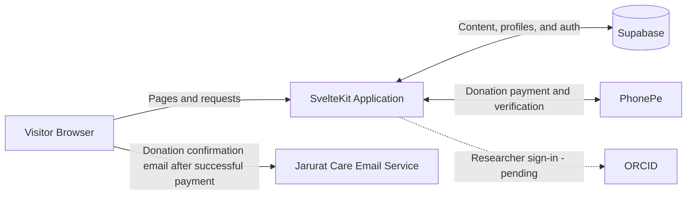

# 🎗️ Jarurat Care Foundation

> **Supporting cancer patients and caregivers with care, information, and community.**

## 🎯 About the Project

**Jarurat Care** is the official website of [Jarurat Care Foundation](https://www.jarurat.care), a non-profit initiative supporting cancer patients and their caregivers across India. The website brings the foundation's work together in one place, helping visitors learn about its mission, find support and trusted information, contribute through donations, and get involved in its community.

Built with **SvelteKit**, **TypeScript**, and **Tailwind CSS**, the website uses **Supabase** for data and authentication.

🌐 **Live website:** [www.jarurat.care](https://www.jarurat.care/)

---

## 🚀 Quick Start (5 Minutes)

### Prerequisites

```text
✅ Node.js 24.x
✅ npm
✅ Git
✅ Supabase project (for database and authentication)
✅ ORCID credentials (only when enabling the pending ORCID integration)
```

### Clone & Install

```bash
# Clone the repository
git clone https://github.com/jaruratcare/jarurat-care-website.git
cd jarurat-care-website

# Install dependencies
npm ci
```

### Environment Setup

Create `.env` in the root directory:

```bash
# Supabase
PUBLIC_CMS_SUPABASE_URL=your_supabase_project_url
PUBLIC_CMS_SUPABASE_ANON_KEY=your_supabase_anon_key
SUPABASE_SERVICE_ROLE_KEY=your_supabase_service_role_key

# ORCID sign-in (pending integration; configure when ready)
ORCID_CLIENT_ID=your_orcid_client_id
ORCID_CLIENT_SECRET=your_orcid_client_secret
ORCID_REDIRECT_URI=http://localhost:5173/cms/auth-callback
```

### Supabase Database Setup

1. Create a project in [Supabase](https://supabase.com/).
2. In the Supabase dashboard, open **Project Settings → API** (or **API Keys**) and copy the project URL and public/anon key into `PUBLIC_CMS_SUPABASE_URL` and `PUBLIC_CMS_SUPABASE_ANON_KEY`.
3. Copy the `service_role` secret key into `SUPABASE_SERVICE_ROLE_KEY`. The server-side admin client uses this key for privileged database operations. Keep it server-only; never add it to client-side code or expose it publicly.
4. Make sure the database has the tables and access policies required by the app. The Community section reads from `articles`, `research_articles`, `cms_content`, and `profiles`, and uses `saved_articles` for saved items.

The repository does not include Supabase SQL migrations, so creating a project and adding its credentials alone may not be enough for a fresh database. The required tables, columns, and Row Level Security (RLS) policies must also be configured in Supabase. Do not use the service-role key as a substitute for correctly configured policies.

Keep `.env` private and never commit it. If a service-role key has been exposed, rotate it in the Supabase dashboard.

### Start the Development Server

```bash
npm run dev
```

Open [http://localhost:5173](http://localhost:5173) in your browser. To check the project or create a production build, run:

```bash
npm run check
npm run build
```

---

## 🏗️ Architecture & Folder Structure

### Architecture Overview



### Key Folders

```text
jarurat-care-website/
├── src/
│   ├── lib/
│   │   ├── components/             # Shared UI, dashboards, and donation components
│   │   ├── assets/                 # Imported images and media
│   │   ├── data/                   # Static JSON content
│   │   ├── cmsSupabase.js          # Browser-side Supabase client
│   │   └── supabaseAdmin.ts        # Server-side Supabase client
│   ├── routes/
│   │   ├── cms/                    # CMS auth and role-based dashboards
│   │   ├── knowledge-hub/          # Community content discovery
│   │   ├── content/                # Public content listing and details
│   │   ├── api/payment/            # PhonePe payment endpoints
│   │   ├── donate/                 # Donation experience
│   │   └── +page.svelte            # Home page
│   ├── hooks.server.ts             # Server hooks and Supabase session setup
│   └── app.css                     # Global styles
├── static/                         # Publicly served static files
├── package.json                    # Dependencies and project scripts
└── vite.config.ts                  # Vite configuration
```

---

## 🛠️ Tech Stack

### Frontend

| Technology | Purpose |
|---|---|
| [SvelteKit](https://kit.svelte.dev/) | Application framework, routing, and server-side rendering |
| [Svelte](https://svelte.dev/) | Component-based user interface |
| [TypeScript](https://www.typescriptlang.org/) | Type-safe application code |
| [Tailwind CSS](https://tailwindcss.com/) | Utility-first styling |
| [Vite](https://vite.dev/) | Development server and build tool |

### Backend & Database

| Technology | Purpose |
|---|---|
| [Supabase](https://supabase.com/) | PostgreSQL database, authentication, and data access |
| [`@supabase/ssr`](https://www.npmjs.com/package/@supabase/ssr) | Supabase clients for browser and server-side sessions |
| [SvelteKit server routes](https://kit.svelte.dev/docs/routing) | Server-side data loading and form actions |

### UI & Content

| Technology | Purpose |
|---|---|
| [TipTap](https://tiptap.dev/) | Rich-text editing for CMS content |
| [Lucide](https://lucide.dev/) | Icons |
| [Splide](https://splidejs.com/) | Carousels and sliders |
| [Marked](https://marked.js.org/) | Markdown rendering |
| [Svelte French Toast](https://svelte-french-toast.com/) | Toast notifications |

### Developer Tools & Deployment

| Technology | Purpose |
|---|---|
| [ESLint](https://eslint.org/) | Code linting |
| [Prettier](https://prettier.io/) | Code formatting |
| [Vercel Adapter](https://www.npmjs.com/package/@sveltejs/adapter-vercel) | SvelteKit deployment adapter |

---

## ⚠️ Known Issues & Pending Work

### Donation Flow

The donation interface and PhonePe payment endpoints are present in the code, but the donation flow is still pending completion and end-to-end verification before it can be considered production-ready.

- Confirm the required PhonePe production configuration is set securely in the deployment environment.
- Test the complete donation journey, including successful, failed, and delayed payment-status responses.
- Verify that the donation confirmation email is delivered by the external Render email service after a successful payment.

### ORCID Sign-In

ORCID sign-in is **not yet ready for production use**. Complete the provider setup and verify the full authentication and registration flow before enabling it for users.

- Configure the ORCID application credentials and production callback/redirect URLs.
- Test new-user registration, existing-account sign-in, and cases where an ORCID profile does not provide an email address.

---

## 👥 Community Section

Jarurat Care's Community is a knowledge and engagement hub for patients, caregivers, healthcare professionals, and the wider community. It brings together **articles, research papers, blogs, news, events, FAQs, testimonials, and campaigns**.

### Exploring Community Content

The Knowledge Hub combines published content from `articles`, `research_articles`, and `cms_content` in one feed.

| Feature | What it does |
|---|---|
| Search and filters | Find content by keyword or content type. |
| Sorting | Order results by date or title. |
| Display options | Switch between grid and list views. |
| Pagination | Browse results in pages of up to nine items. |
| Content pages | Open an item to read its full details. |

**Main routes:** `/knowledge-hub` for browsing, `/content/{type}/{slug}` for content details, and `/doctors/{id}` for public Doctor profiles.

### Accounts & Access

Community accounts use **Supabase Authentication**. Users can sign up with an email and password or continue with Google.

| Sign-in option | Details |
|---|---|
| Email and password | Sign-up validates the email and requires a password of at least eight characters. Supabase creates the account; the app creates a matching `profiles` record with the initial role `user`. |
| Email verification | The sign-up flow asks users to verify their email before logging in. Email confirmation must be enabled in Supabase for this to be enforced. |
| Google | Supabase OAuth sign-in; callback route: `/cms/auth-callback`. |
| ORCID | **In progress** — setup and end-to-end sign-in are pending. |
| Password recovery | Users can request a reset link by email and set a new password. |

After sign-in, users complete their profile as a Reader or Doctor. Doctor accounts must be approved before they can access Doctor authoring features.

> **Deployment note:** Email verification currently redirects to `http://localhost:5173/cms/login?verified=true`. Update this URL for production and add it to Supabase's allowed redirect URLs.

### Roles & Permissions

Access is determined by `profiles.role`. Doctor accounts also use the `is_author` and `is_reviewer` flags. **Role values are case-sensitive.**

| Account type | Role / flags | Main access |
|---|---|---|
| Visitor | Not signed in | Read published content and view public Doctor profiles |
| New user | `user` | Complete their profile |
| Reader | `Reader` | Use member features and the Reader dashboard |
| Doctor / author | `Doctor`, approved, `is_author = true` | Create article and research submissions |
| Reviewer | `Doctor`, `is_reviewer = true` | Review other Doctors' submissions; can also author if `is_author = true` |
| Admin | `Admin` | Manage CMS content |
| Super Admin | `Super_Admin` | Approve Doctors, manage roles, and final-publish Doctor submissions |

> **Reviewer is a Doctor permission, not a separate role.**

> **Current implementation caveat:** Admins can also access the Super Admin area and perform some Super Admin actions. Save, like, comment, and follow actions are available to any signed-in user, not only Readers.

### Publishing Workflow

Doctor articles and research require review before publication:

```text
Doctor registration → Super Admin approval → Doctor submits content
                    → Reviewer approves or requests changes
                    → Super Admin publishes → Visible in Community
```

Reviewer approval records the review outcome; it does **not** publish the submission.

Blogs, news, events, FAQs, and campaigns use a separate CMS flow:

```text
Admin or Super Admin creates/edits → Publishes → Visible publicly
                                   → Unpublishes → Returns to draft
```

CMS content does not go through the Doctor/Reviewer review process.

### CMS & Reader Features

| Area | What users can do |
|---|---|
| Admin dashboard | Create, edit, publish, unpublish, and manage CMS content. |
| Doctor dashboard | Create and manage the Doctor's own article and research submissions. |
| Reviewer queues | Review other Doctors' submissions and approve them or request changes. |
| Super Admin dashboard | Approve Doctors, manage roles and author permissions, publish Doctor submissions, and manage CMS content. |
| Reader dashboard | Find saved content, followed Doctors, recommendations, and profile interests. |

Readers and other signed-in members can save content, like and comment on content, and follow Doctors. Visitors can browse published content and public Doctor profiles; **sign-in is required for member interactions**.

### Community Database

Community data is stored in **Supabase**. The table list below comes from the project dashboard; names are grouped by their apparent purpose.

| Area | Tables |
|---|---|
| Profiles & authors | `profiles`, `author_profiles`, `author_requests` |
| Articles & editorial | `articles`, `article_comments`, `article_likes`, `article_versions`, `research_articles`, `research_article_comments`, `research_article_likes`, `review_comments` |
| CMS & testimonials | `cms_content`, `testimonials` |
| Community activity | `doctor_followers`, `doctor_follows`, `saved_articles`, `saved_research_articles`, `notifications` |
| Analytics | `analytics_events` |

#### Key tables and relationships

The schema diagram shared for this project shows the following fields and links:

| Table | Visible fields | Purpose |
|---|---|---|
| `profiles` | `id` (UUID), `email`, `full_name`, `role`, `profile_completed`, `verification_status`, and profile, professional, and preference fields | Stores the Community member profile and role information. |
| `articles` | `id` (UUID), `author_id` (UUID), `title`, `excerpt` | Stores article records and their author reference. |
| `saved_articles` | `id`, `user_id`, `article_id`, `created_at`, `content_type` | Links a member to saved content. |
| `doctor_follows` | `id`, `follower_id`, `doctor_id`, `created_at` | Records which member follows which Doctor. |
| `analytics_events` | `id`, `user_id`, `event_type`, `content_id`, `content_type`, `session_id`, `created_at` | Records user or session activity associated with content. |
| `notifications` | `message`, `link`, `is_read`, `created_at`, `type` | Stores notification details and read status. |

The diagram shows user-related references from `saved_articles.user_id`, `doctor_follows.follower_id`, and `analytics_events.user_id` to `profiles.id`; `articles.author_id` is also linked to a profile. Only the fields visible in the shared diagram are listed here; it does not show every column in every table.

#### Row Level Security (RLS)

The shared Supabase Policies screen shows RLS enabled for `profiles` and `author_profiles` (the dashboard offers **Disable RLS** for both tables).

| Table | Policies shown in the dashboard |
|---|---|
| `author_profiles` | `Allow all authenticated` — `ALL` for `authenticated` |
| `profiles` | `Allow all authenticated` — `ALL` for `authenticated`; `Allow anon insert` — `INSERT` for `anon`; `Allow insert for authenticated users` — `INSERT` for `authenticated`; `Users can insert own profile` — `INSERT` for `public`; `Users can update own profile` — `UPDATE` for `public`; `Users can view own profile` — `SELECT` for `public` |

> **Important:** The screenshot shows policy names, commands, and applied roles, but not the policy expressions (`USING` / `WITH CHECK`). It also does not show RLS status for the other tables. Review each policy's definition and the remaining tables before treating this as a complete security audit.

The repository does not include Supabase migrations, so this README is an overview of the shared dashboard/schema screenshots and application code—not a full database definition.

### Security & Access Controls

- **Verified sessions:** Server-side session handling validates the signed-in user with Supabase before treating a session as authenticated.
- **Protected save action:** Saving an article is checked on the server and requires an authenticated session; unauthenticated requests are rejected.
- **Sign-up validation:** Registration checks email format and domain, blocks known disposable email providers, and requires a minimum eight-character password.
- **Role and approval flow:** Doctor access depends on profile completion and approval status. Doctor content follows reviewer approval and Super Admin publication.
- **Server-only admin key:** `SUPABASE_SERVICE_ROLE_KEY` is used by a server-side Supabase client and must never be exposed to browser code or committed to the repository. This key bypasses Row Level Security (RLS), so database policies and server-side access checks must be configured carefully.

> **Security configuration:** Enable Supabase email confirmation if verified email is required, and configure RLS policies for the project’s tables. The repository does not include database migrations or a complete RLS policy set.

### Known Community Gaps

| Area | Current behavior | Follow-up |
|---|---|---|
| Admin sign-in redirect | Admin login redirects to `/cms/admin`, while the dashboard route is `/cms/admin-dashboard`. | Align the redirect with the active dashboard route. |
| Public Doctor profiles | The profile route filters for `role = 'Doctor'`, but does not check for approved verification status. | Confirm whether only approved Doctors should be publicly visible, then apply that rule consistently. |
| Reviewer approval | Reviewer approval is recorded in a feedback field; the submission remains `under_review` until Super Admin publication. | Keep the review and final-publishing stages distinct when maintaining the workflow. |
| Testimonial management | Testimonials use a separate contributor flow and are not included in the CMS content type picker. | Confirm whether Admin moderation/management should be added to the CMS. |

---

## 📬 Support & Contact

For general questions or support related to Jarurat Care, visit the [Contact Us page](https://www.jarurat.care/contact-us) or email [connect@jarurat.care](mailto:connect@jarurat.care).

---

*Maintained by Jarurat Care Foundation.*
